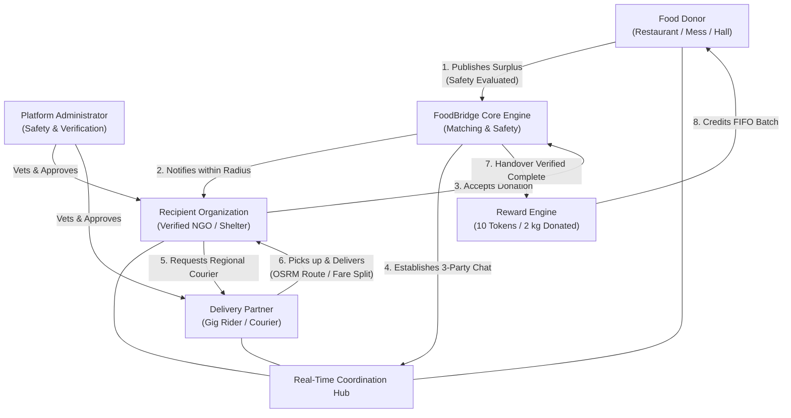
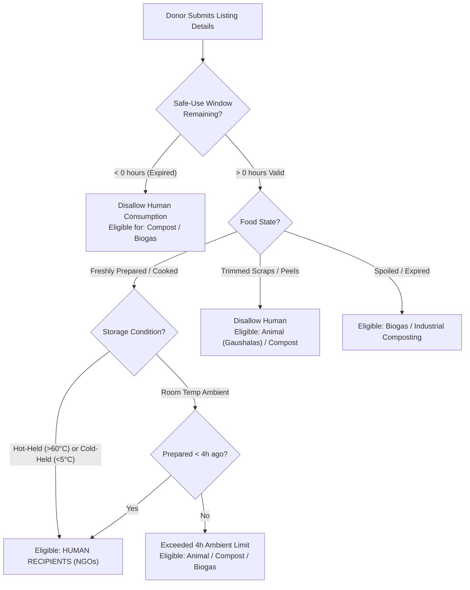
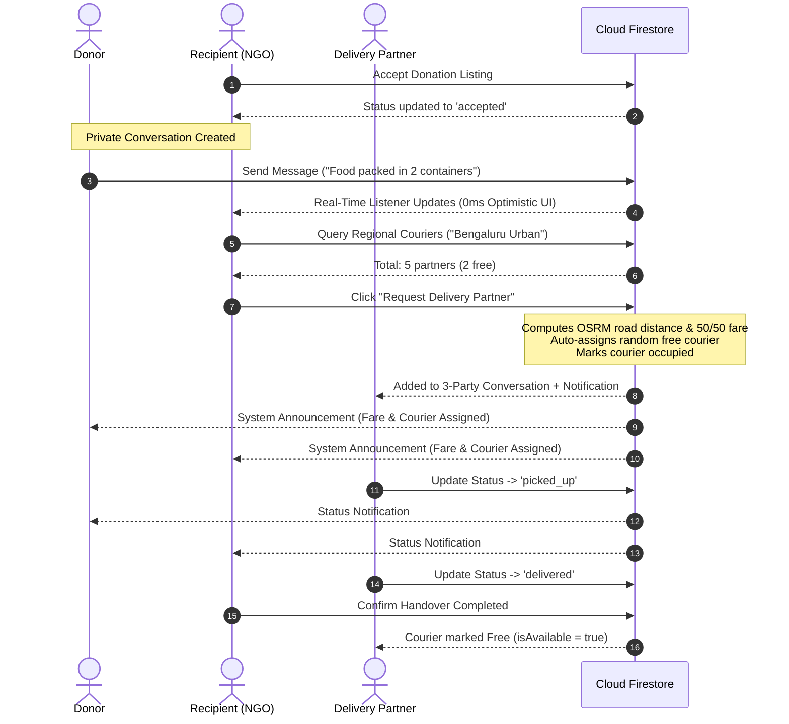
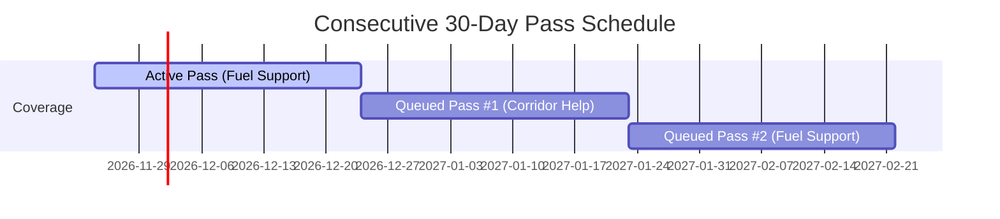
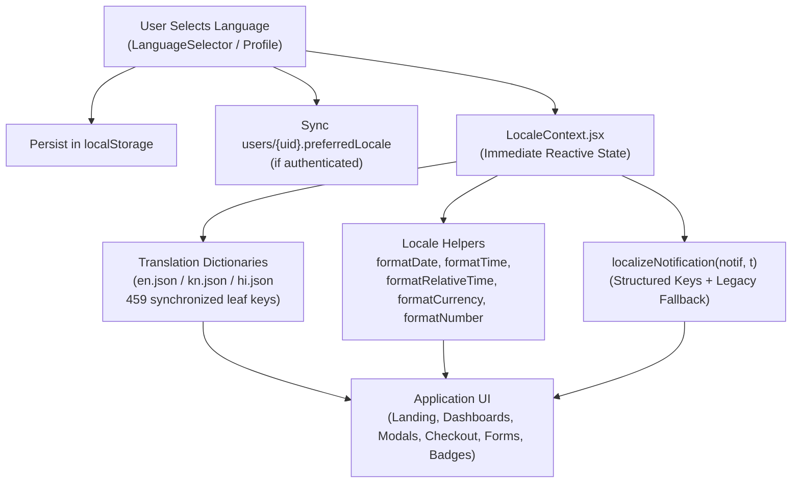

# FoodBridge Karnataka: Comprehensive Project Report & System Architecture

```
Project Name:       FoodBridge (Karnataka Food Redistribution Platform)
Pilot District:     Tumakuru & Bengaluru Urban, Karnataka, India
Core Mission:       Bridging surplus food to verified community organizations through deterministic safety, 
                    real-time logistics coordination, consecutive membership stacking, and transparent public impact tracking.
License & Model:    Zero-Cost Civic Architecture (OpenStreetMap, Leaflet, Firebase Free Tier, Complete Multilingual Support)
Repository:         https://github.com/ayush451/foodbridge_v1
Last Updated:       November 2026
```

---

## 1. Executive Summary

**FoodBridge** is a purpose-built, civic food recovery and redistribution web platform designed for the state of Karnataka, India. It bridges the critical divide between commercial food surplus generators (restaurants, banquet halls, caterers, college messes, and corporate cafeterias) and verified recipient organizations (orphanages, elder care shelters, community kitchens, animal shelters, and organic bio-recyclers).

Unlike traditional charity bulletin boards or informal messaging groups that frequently suffer from food spoilage, recipient overwhelm, logistical bottlenecks, and compromised safety, FoodBridge enforces:
1. **Deterministic Food Safety & Dignity Classification**: Rules-based automated safety vetting before food can be dispatched for human consumption.
2. **Automated Geospatial Matching & Expanding Radius Engine**: Starting within a tight 1.5 km neighborhood cluster to ensure fresh food reaches nearby recipients within safe time limits.
3. **Three-Party Real-Time Coordination**: Donor, Recipient NGO, and Delivery Partner united in a synchronized in-app group chat.
4. **Zero-Cost Road Routing & Transparent 50/50 Fare Split**: OpenStreetMap OSRM driving distance calculation with a shared base + per-km delivery cost model.
5. **Realistic Simulated Payment & Consecutive Membership Stacking**: Safe sandbox checkout supporting Card, UPI, and Net Banking with non-overlapping 30-day passes.
6. **Weight-Based Token Reward System (10 Tokens per 2 kg Donated)**: Verified donation completion rewards with immutable listing traceability, calculation transparency, and FIFO valuation.
7. **Clean High-Contrast UI & Dual Demo Mode**: High-contrast, WCAG AAA compliant styling matching brand dark green, accompanied by a switchable Normal Mode / Demo Mode toggle.
8. **Complete Application-Wide Multilingual Architecture**: Comprehensive localization across English, Kannada (ಕನ್ನಡ), and Hindi (हिन्दी) with native font rendering and dynamic notification templates.
9. **Public Impact Tracking & Anonymized 3D Globe Visualization**: Strictly aggregating verified completed handovers using FSSAI, FAO, and UNEP greenhouse gas metrics.

---

## 2. The Problem Statement: Why FoodBridge Was Built

### 2.1 The Surplus-Deficit Paradox
Every day across Karnataka's urban and tier-2 hubs (Bengaluru, Tumakuru, Mysuru, Hubballi), hundreds of kilograms of freshly cooked food, commercial pantry supplies, and raw produce are discarded by commercial kitchens. Simultaneously, verified charitable institutions, children's shelters, and elder homes struggle with volatile food budgets and nutritional deficits.

### 2.2 Past Failures of Informal Food Donation
Prior informal efforts (WhatsApp groups, phone calling trees, ad-hoc pickups) routinely encounter systemic failures:
1. **The "Dumping Ground" Problem (Loss of Food Dignity)**: Donors often attempt to donate food that has already exceeded its safe-use window or has begun spoiling. Receiving stale or spoiled food forces charitable shelters to pay disposal costs and puts vulnerable populations at risk of food poisoning.
2. **Logistical Paralysis**: A small orphanage rarely has transport vehicles or staff available on short notice to collect 80 kg of hot food across town. Without a coordinated courier partner, the food spoils.
3. **Unfair Cost Burden**: Couriers or volunteers bear transport fuel costs out of pocket, or transport expenses fall entirely on underfunded NGOs.
4. **Lack of Trust, Verification & Privacy**: Donors fear regulatory liability, while recipients fear uninspected food. Publicly broadcasting donor or recipient addresses leads to unwanted intrusions.
5. **Language & Accessibility Barrier**: Many grassroots shelter managers and logistics volunteers in Karnataka speak and read Kannada or Hindi rather than English. Single-language interfaces prevent community adoption.

### 2.3 Environmental Toll (Landfill Methane Emissions)
Organic waste discarded into municipal landfills undergoes anaerobic decomposition, releasing methane ($\text{CH}_4$)—a greenhouse gas with over 28 times the global warming potential of $\text{CO}_2$ over a 100-year timescale. According to UNEP guidelines, **diverting 1 kg of food surplus from landfills directly avoids 2.5 kg of $\text{CO}_2\text{e}$ emissions**.

---

## 3. Core Philosophy & Architectural Pillars

| Pillar | Principle | Implementation in FoodBridge |
| :--- | :--- | :--- |
| **Food Dignity First** | Food donated for humans must meet conservative safety and temperature standards. | Deterministic Food Safety Engine classifies items as *Human*, *Animal*, *Compost*, or *Biogas*. Expired items are strictly rejected for human consumption. |
| **Zero-Cost Civic Stack** | The platform must be sustainable with zero reliance on paid commercial APIs or proprietary subscriptions. | Built using Leaflet 1.9.4, OpenStreetMap tiles, Project-OSRM public road routing, and Firebase Spark/free tier. |
| **Fair Cost Logistics** | Courier delivery must be financially viable and fairly distributed. | 50/50 automatic delivery fee split between Donor and Recipient with predictable base + per-km pricing. |
| **Consecutive Stacking** | Multiple membership passes must stack consecutively without overlapping days. | Queue-ordered schedule calculating true remaining duration strictly from Firestore passes. |
| **Traceable Rewards** | Rewards must incentivize real rescue volume (10 tokens / 2 kg) with zero gaming. | Automated calculation on completed handovers linked directly to listing reference and audited batches. |
| **Design Integrity & Accessibility** | High visual contrast, legible typography, and no clutter. | Brand dark green palette (`#1b4332`), WCAG AAA text contrast, and Demo Mode toggle to eliminate testing clutter. |
| **Full Multilingual Inclusion** | Complete parity across English, Kannada, and Hindi. | Centralized 459-key dictionary, dynamic notification templates, and Noto Sans Kannada/Devanagari scripts. |
| **Privacy by Design** | Exact geographic addresses and personal contact details are protected. | Coordinates and contact numbers are masked until a mutual match is accepted; public 3D interactive globe renders only anonymized district centroids. |
| **Immutable Accountability** | Every verification, donation transition, and administrative action must be auditable. | Strict Firestore Security Rules enforce append-only audit trails, preventing unilateral data tampering. |

---

## 4. Platform Roles & User Journeys

FoodBridge operates as a multi-sided ecosystem with 4 operational roles + administrative oversight:



### 4.1 The Food Donor
* **Surplus Listing Creation**: Instant food safety evaluation, shelf-life calculation, dietary tagging (Veg / Non-Veg / Vegan), and unit conversion (kg, litres, portions).
* **Workspace Dashboard**: Active matching monitors, accepted donations, live transit indicators, and historical recovery archives.
* **Redesigned Wallet & Rewards Dashboard**:
  * **Current Active Pass**: Displays active plan, start date, expiry date, days remaining ($\le$ 30 days), and current reward rate.
  * **Upcoming Memberships**: Displays queue order, start/expiry dates, and scheduled activation.
  * **Total Membership Coverage**: Aggregated remaining duration and final coverage date.
  * **Membership Timeline Schedule**: Expandable pass details with cancellation policies.
  * **Payment History**: Filterable by status, payment method, purpose, and date presets.
  * **FIFO Reward Ledger**: Inspectable reward batches with listing references, quantities, and valuations.
  * **Token Redemption Modal**: Multiples of 100 redemption with FIFO payout projection to UPI.
* **Realistic Checkout Simulation**: Safe Card, UPI, and Net Banking flows with consecutive pass creation.
* **Demo Mode Toggle**: Switches between clean user view and developer diagnostic view.

### 4.2 The Recipient Organization (NGO / Shelter)
* **Structured Verification Onboarding**: FCRA / 12A / 80G registration docs, facility photos, and intake capacity.
* **Available Donations Feed**: Filtered by geographic radius and dietary categories (Human vs Animal).
* **1-Click Donation Acceptance**: Atomic concurrency locking prevents race conditions.
* **Accepted / Handover Workflow**: Direct verification of donor handovers.
* **1-Click "Request Delivery Partner"**: Instant dispatch querying regional courier availability with automated 50/50 fare calculation.
* **Interactive Route Map**: Real-time road route, pickup/drop coordinates, and fare share.

### 4.3 The Delivery Partner
* **Verification Onboarding**: Driving License, vehicle type (Two-Wheeler / Three-Wheeler / Mini-Truck).
* **Real-Time Availability Toggle**: Simple online/offline switch (`isAvailable: true/false`).
* **Automated Regional Assignment**: Dispatched based on district proximity when delivery is requested.
* **Three-Party Synchronized Chat**: Real-time communication with donor and recipient.
* **Turn-by-Turn Route Map**: Stepwise transit status transitions: `ASSIGNED` $\rightarrow$ `PICKED_UP` $\rightarrow$ `DELIVERED`. Auto-freed for new assignments upon completion.

### 4.4 The Platform Administrator
* **Verification Queue**: Document verification viewer for NGOs and Couriers with Approve, Reject with Reason, or Request Info actions.
* **Live Monitoring & Oversight**: Listing oversight, suspension controls, and dispute resolution.
* **Memberships & Rewards Oversight**:
  * Support transaction audit trails across all donors.
  * Individual membership period inspection and queue verification.
  * Reward ledger audit log tracking token generation per completed rescue.
  * Daily platform and donor-recipient pair limit monitor.
  * Administrative approval and simulated payout processing for token redemption requests.
* **Immutable Audit Trail**: Append-only security logging for all administrative actions.

---

## 5. Core Algorithmic & Functional Engines

### 5.1 The Deterministic Food Safety Engine (`safetyEngine.js`)

FoodBridge eliminates donor ambiguity by using an automated rules engine based on food dignity standards:



#### Safe Storage & Temperature Thresholds:
* **Freshly Prepared Food**: Must be held hot ($> 60^\circ\text{C}$), cold ($< 5^\circ\text{C}$), or consumed within 4 hours if stored ambient ($20-25^\circ\text{C}$).
* **Allergen Declarations**: Standardized audit for Nuts, Dairy, Gluten, Soy, Eggs, Mustard, or No Known Allergens.
* **Vegetarian Separation**: Strict segregation ensuring non-vegetarian items are never routed to vegetarian shelters or gaushalas.

---

### 5.2 Geospatial Matching & Expanding Radius Engine (`matchingEngine.js`)

To preserve food freshness and minimize transit emissions, FoodBridge utilizes an expanding radius dispatch model:

$$\text{Initial Match Radius} = 1.5\text{ km}$$
$$\text{Radius Expansion Schedule} = [1.5\text{ km} \rightarrow 3.0\text{ km} \rightarrow 6.0\text{ km} \rightarrow 10.0\text{ km} \rightarrow 15.0\text{ km}]$$

* **Haversine Distance Formula**: Instant, zero-cost, offline-capable trigonometric distance:
  $$d = 2R \cdot \arcsin\left(\sqrt{\sin^2\left(\frac{\Delta \phi}{2}\right) + \cos(\phi_1)\cos(\phi_2)\sin^2\left(\frac{\Delta \lambda}{2}\right)}\right)$$
  Where $R = 6371\text{ km}$.
* **Idempotent Concurrency Lock**: When a recipient clicks **"Accept Donation"**, an atomic Firestore update checks `status == 'matching'`. If two NGOs click simultaneously, exactly one succeeds; the second receives a graceful notification that the listing was already claimed.

---

### 5.3 Real-Time Chat & Delivery Coordination System (`chatService.js` & `deliveryService.js`)

Communication is tied directly to the donation document (1 conversation per accepted donation).



---

### 5.4 Road Routing, Distance & 50/50 Fare Pricing (`routingService.js` & `deliveryPricing.js`)

Rather than relying on inaccurate straight-line estimates, FoodBridge interfaces with OpenStreetMap's Project-OSRM public driving routing API:

$$\text{Raw Fare} = \text{Base Fee (₹40)} + (\text{Per-km Rate (₹12)} \times \text{Road Distance in km})$$
$$\text{Total Fare} = \max(\text{Minimum Fare (₹50)},\; \text{round}(\text{Raw Fare}))$$
$$\text{Donor Share} = \text{round}\left(\frac{\text{Total Fare}}{2}\right)$$
$$\text{Recipient Share} = \text{Total Fare} - \text{Donor Share}$$

* **Leaflet Coordinate Alignment**: OSRM returns GeoJSON coordinates as `[lon, lat]`. The service automatically transposes them to Leaflet's `[lat, lon]` pairs.
* **Failover Engine**: If the OSRM server is slow or unreachable ($> 4000\text{ ms}$), the system smoothly falls back to Haversine distance scaled by a 1.3× urban winding factor.

---

### 5.5 Realistic Simulated Payment & Checkout System (`PaymentModal.jsx` & `membershipService.js`)

FoodBridge features a realistic simulated checkout experience for Donor memberships without involving real financial transactions:
* **Payment Methods**:
  1. **Credit / Debit Card**: Simulated cardholder name, masked card number (`4532 •••• •••• 8892`), MM/YY expiry, and dummy CVV.
  2. **UPI**: Virtual Payment Address input with quick-fill shortcuts (`donor@okhdfcbank`, `donor@upi`).
  3. **Net Banking**: Bank dropdown featuring major Indian institutions (SBI, HDFC, ICICI, Axis, PNB, Canara) with simulated customer authentication.
* **Realistic Lifecycle States**: Initiated $\rightarrow$ Gateway Authorization $\rightarrow$ Bank Stacking Validation $\rightarrow$ Success, Failed, or Cancelled.
* **Security & Non-Storage Guarantee**: Zero banking credentials (card numbers, CVVs, UPI PINs, passwords) are ever recorded in Firestore. Only safe metadata (`amount`, `paymentMethod`, `last4`, `status`, `timestamp`) is logged.
* **Failed / Cancelled Isolation**: Failed or cancelled attempts never activate or queue memberships and are safely retained in the audit history.

---

### 5.6 Consecutive Membership Stacking & Pass Lifecycle Engine (`membershipService.js`)

When Donors purchase multiple 30-day support passes (Fuel Support ₹100 or Corridor Help ₹250), they stack consecutively without overlapping days:



* **Separation of Concepts**:
  * **Current Active Pass**: Strictly capped to $\le$ 30 days remaining in the active cycle.
  * **Upcoming Memberships**: Array of queued passes sorted by activation order (`Queue #1`, `Queue #2`).
  * **Total Membership Coverage**: Sum of remaining days across all active and queued passes, pointing to the final coverage date.
* **Cancellation Lifecycle**:
  * **Active Pass Cancellation**: Benefits remain 100% active through the current cycle's scheduled end date (`NON-RENEWING` status) and do not auto-renew.
  * **Queued Pass Cancellation**: The cancelled pass is removed, and subsequent queued passes automatically shift forward by 30 days to preserve uninterrupted coverage.

---

### 5.7 Weight-Based Token Reward System (10 Tokens / 2 kg) (`rewardService.js` & `walletService.js`)

Donors earn platform tokens based on actual food rescued:

$$\text{Tokens Earned} = \left(\frac{\text{Food Quantity in kg}}{2}\right) \times 10$$

| Food Quantity | Tokens Earned | Notes |
| :--- | :---: | :--- |
| 1.0 kg | 5.0 | Fractional quantities supported proportionally |
| 2.0 kg | 10.0 | Baseline earning rate |
| 3.5 kg | 17.5 | No round-down penalties |
| 10.0 kg | 50.0 | Proportional scaling |
| 20.0 kg | 100.0 | Eligible for immediate single redemption block |

#### Rules & Anti-Gaming Constraints:
1. **Crediting Trigger**: Tokens are credited **only upon verified completed handover** (`status == 'completed'`).
2. **Donor Exclusive**: Tokens are awarded exclusively to Donors; NGOs and couriers never receive tokens.
3. **Membership Gating**: Tokens generate only if the Donor holds an active support membership on completion.
4. **Immutable Donation Traceability**: Every token credit creates a `rewardLedger` batch linked to:
   * Unique Reward Transaction ID.
   * Donor User ID and Name.
   * Original Listing ID & Title.
   * Handover ID & Donation ID.
   * Food quantity in kg and applied formula.
   * Active membership plan and applicable redemption rate.
   * Timestamp and batch status.
5. **Anti-Gaming Caps**:
   * Maximum 3 rewarded donations per unique Donor-Recipient pair per IST calendar day.
   * Maximum 10 rewarded donations across the entire platform per Donor per IST calendar day.
6. **FIFO Batch Redemption**: Redemptions deduct from the oldest batches first, strictly preserving the original earning rate (₹2/100 tokens for Fuel Support, ₹6/100 tokens for Corridor Help).

---

### 5.8 High-Contrast UI & Demo Mode Architecture

The Donor Wallet & Rewards dashboard enforces strict design requirements:
* **Brand Consistency**: Uses FoodBridge's signature dark green palette (`#1b4332`, `#2d6a4f`) on clean white or subtle off-white backgrounds (`bg-gray-50`, `bg-white`).
* **Text Contrast (WCAG AAA)**: Eliminates washed-out gray text, dark text on dark backgrounds, or white text on light backgrounds. All headings, labels, badges, and values maintain high visual contrast.
* **Demo Mode Toggle**:
  * **Normal Mode (Default)**: Completely removes developer diagnostics, testing metrics ("Total Demo Spent"), demo badges, and testing controls.
  * **Demo Mode**: Allows developers and testers to inspect mock checkout states and demo transaction counters.

---

### 5.9 Complete Multilingual Architecture (`LocaleContext.jsx`)

FoodBridge provides full application-wide localization across **English**, **Kannada (ಕನ್ನಡ)**, and **Hindi (हिन्दी)**:



* **No Untranslated English Fallbacks**: Every user-facing UI component, card, button, heading, error notice, and empty state is wired to translation keys.
* **Variable Interpolation**: Supports `{var}` and `{{var}}` placeholders for dynamic parameters (`{quantity}`, `{amount}`, `{donorName}`, etc.).
* **Preservation of User-Generated Content**: Listing titles, user names, addresses, and chat messages entered by users are preserved in their original form.
* **Native Typography**: Preconnected Google Fonts links for `Noto Sans Kannada` and `Noto Sans Devanagari` in `index.html` and `tailwind.config.js` guarantee flawless glyph and ligature rendering without clipping.

---

### 5.10 Public Impact & Nutritional Metrics Engine (`impactService.js`)

Public metrics displayed on the landing page and impact dashboard are **strictly computed from verified, completed handovers**:
* **Standard Portion Baseline**: In accordance with FSSAI and FAO guidelines, **1 standard nutritional meal = 0.4 kg (400g)**.
  $$\text{Meals} = \text{round}\left(\frac{\text{Weight in kg}}{0.4}\right)$$
* **Landfill Methane Avoidance**: In accordance with UNEP greenhouse gas inventory standards:
  $$\text{CO}_2\text{e Avoided (kg)} = \text{Weight in kg} \times 2.5$$
* **Zero Ghost Records**: Pending, cancelled, expired, or disputed listings are defensively excluded from all public impact tallies.

---

## 6. Technical Specifications & Architecture

### 6.1 Complete Technology Stack

| Layer | Technology | Purpose |
| :--- | :--- | :--- |
| **Runtime & Build** | Node.js, Vite 5.4 | Fast HMR development and optimized production bundling (4GB memory-safe) |
| **Frontend Framework** | React 18.3, React Router v6 | Single Page Application (SPA) architecture with declarative routing |
| **Internationalization** | Custom Reactive Locale Context | 3 locales (English, Kannada, Hindi) with interpolation & date/time formatting |
| **Typography** | Noto Sans Kannada, Noto Sans Devanagari, Inter | Native Indian script rendering with clean ligature support |
| **Styling & UI** | Tailwind CSS 3.4, PostCSS | WCAG AAA compliant color scheme matching the primary `#1b4332` brand |
| **Icons & Visuals** | Lucide React | Feather-based lightweight vector icons |
| **Interactive 3D Globe** | Three.js 0.168 | Anonymized interactive 3D Earth visualization showing Karnataka hub corridors |
| **Map & Polyline Route**| Leaflet 1.9.4 | Interactive road map modal with custom SVG markers and polyline rendering |
| **Authentication** | Firebase Authentication | Email/Password & Google OAuth with local persistence |
| **Database** | Cloud Firestore | Real-time NoSQL database with offline persistence and forced long-polling |
| **Cloud Storage** | Firebase Storage | Secure verification document uploads (FCRA, 80G, DL) |
| **Testing Suite** | Vitest 2.1, React Testing Library | Unit, integration, translation completeness, and navigation test suites |

---

### 6.2 Cloud Firestore Security Rules Structure (`firestore.rules`)

Security rules enforce access control at the database layer across 16 document collections:
* `users`: Users can read/update their own profile. Non-admins cannot self-elevate to admin. Updating `preferredLocale` is permitted.
* `recipients`: Only verified, un-suspended organizations can accept matching donations. Verification statuses can only be modified by admins.
* `deliveryPartners`: Public status flags (`isAvailable`, `activeDeliveryId`) can be updated during dispatch by authenticated participants; verification status is locked to admins.
* `listings`: Donors create matching listings; verified recipients can claim open listings atomically; couriers update transit states; admins hold oversight.
* `deliveries`: Read/write access is restricted to the specific donor, recipient, assigned courier, and admin.
* `notifications`: Authenticated creation; read/update restricted to the recipient user. Supports structured localization keys.
* `conversations` & `messages`: Restricted to authenticated participants linked to that specific donation listing.
* `auditLogs`: Append-only collection writeable only by platform administrators.
* `memberships`: Restricted exclusively to Donors and Admins.
* `supportTransactions`: Safe logging of simulated metadata; accessible by user and Admin.
* `wallets`: Read-only/update for Donors and Admins.
* `rewardLedger`: Append-only token batches with immutable traceability. Deletions strictly forbidden (`allow delete: if false;`).
* `redemptionRequests`: Exclusively Donors and Admins.
* `dailyRewardCounters` & `dailyPairRewardCounters`: Atomic daily anti-gaming limits.
* `membershipPeriods`: Individual 30-day passes managed under consecutive stacking rules.

---

## 7. Karnataka Geographic Context & Regional Hubs

FoodBridge is tailored to Karnataka's civic geography:
* **Tumakuru Pilot Hub**: Primary demonstration regional pilot hub ($13.3409^\circ\text{ N}, 77.1010^\circ\text{ E}$), coordinating educational institutions, local messes, and nearby shelters.
* **Bengaluru Urban Corridor**: High-density restaurant and tech park recovery corridor ($12.9716^\circ\text{ N}, 77.5946^\circ\text{ E}$).
* **Mysuru & Hubballi Corridors**: Active secondary regional municipal hubs.
* **Privacy Centroids**: Exact facility locations are strictly hidden on public maps; only district geographic centroids are used for public corridor rendering.

---

## 8. Verification & Quality Assurance Summary

The platform has been validated against extensive automated test suites and production build verification:

```
Test Suites:  Translation Completeness (4/4 passed)
              Locale Context Formatting & Interpolation (passed)
              Safety Engine & Lifecycle (passed)
              Geospatial Matching & Concurrency (passed)
              Delivery Pricing & OSRM Fallback (passed)
              Reward Calculation & Traceability (passed)
Vite Build:   Production build compiled in 16.28s with 0 errors (4GB heap allocation).
```

---

## 9. Summary & Future Scope

FoodBridge establishes an automated, dignified, zero-cost pipeline for surplus food recovery. By replacing chaotic informal groups with a deterministic rules engine, real-time 3-party coordination, OpenStreetMap road routing, equitable 50/50 logistics pricing, consecutive membership stacking, volume-based token rewards, high-contrast accessible UI, and seamless Kannada/Hindi multilingual support, the platform safeguards food dignity while actively fighting hunger and landfill emissions across Karnataka.
